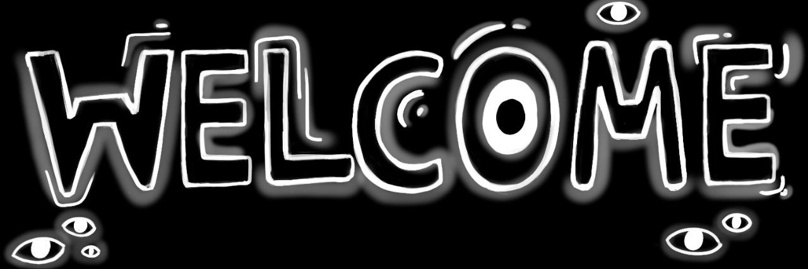

  

---

## 📊 GitHub Stats

  
  

---

## 👋 About Me

- 👤 Im **VechniyRabotnik**  
- 🏗️ Founder of **[TinyMadness](https://tinymadness.online)** (localization & game projects)

---

## 🔧 Technologies

-   C# / .NET / WPF / Avalonia (in the process of learning)
-   Go 
-   Dart / Flutter
-   Lua / Glua
-   HTML / CSS / JS / React 
-   Unity
-   Git / GitHub / Docker / Visual Studio / VS Code

---

## 🚀 My Projects

### My main project
- [TinyMadness](https://tinymadness.online)

### Garry's Mod Addons
- [VechnLY_amnestics](https://github.com/VechniyRabotnik/VechnLY_amnestics)  
- [Vechniy-Doorbust-System](https://github.com/VechniyRabotnik/Vechniy-Doorbust-System)  
- [Vechniy-SCP-006](https://github.com/VechniyRabotnik/Vechniy-SCP-006) 
- [Vechniy-SCP-008](https://github.com/VechniyRabotnik/Vechniy-SCP-008)  
- [Vechniy-SCP-012](https://github.com/VechniyRabotnik/Vechniy-SCP-012)  
- [Vechniy-SCP-019](https://github.com/VechniyRabotnik/Vechniy-SCP-019)

### Golang
- [GolangTicTacToe](https://github.com/VechniyRabotnik/GolangTicTacToe)  
- [GolangToDoListConsole](https://github.com/VechniyRabotnik/GolangToDoListConsole)
- [VechnASCIIArt](https://github.com/VechniyRabotnik/VechnASCIIArt)  

### Competitions and hackathons
- [CodeRun-Yandex-2025](https://github.com/VechniyRabotnik/CodeRun-Yandex-2025)  
- [BORSCH.](https://github.com/VechniyRabotnik/BORSCH._Flagman)
---
